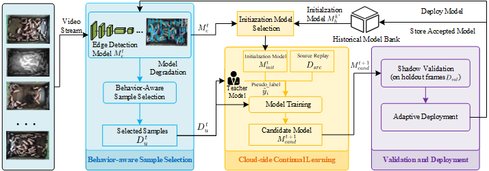
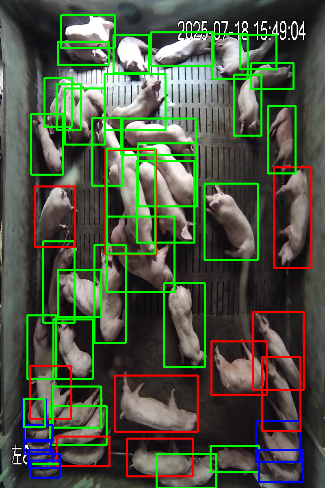
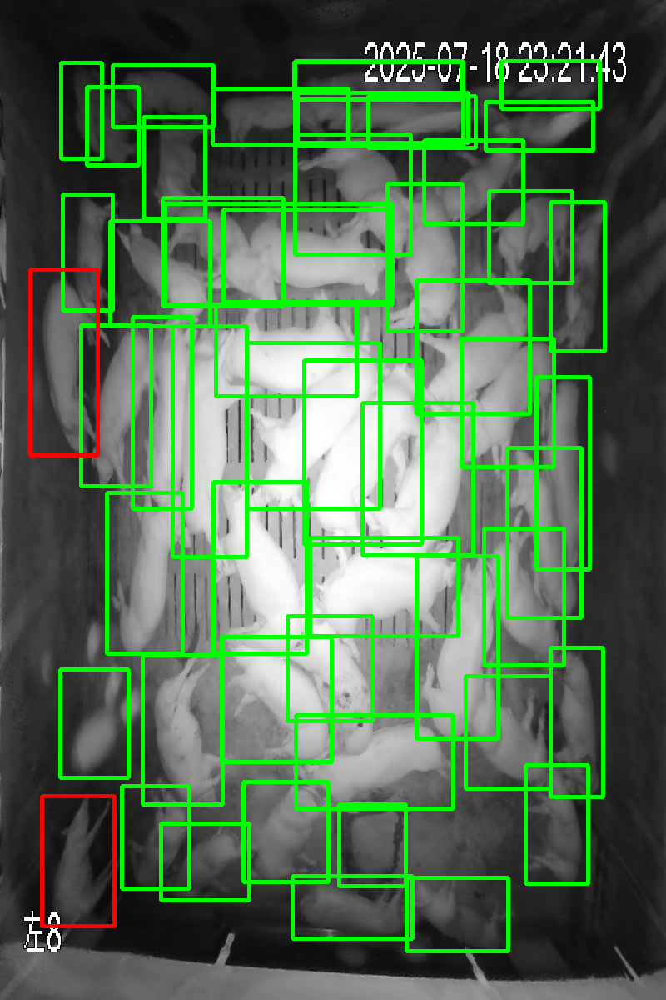
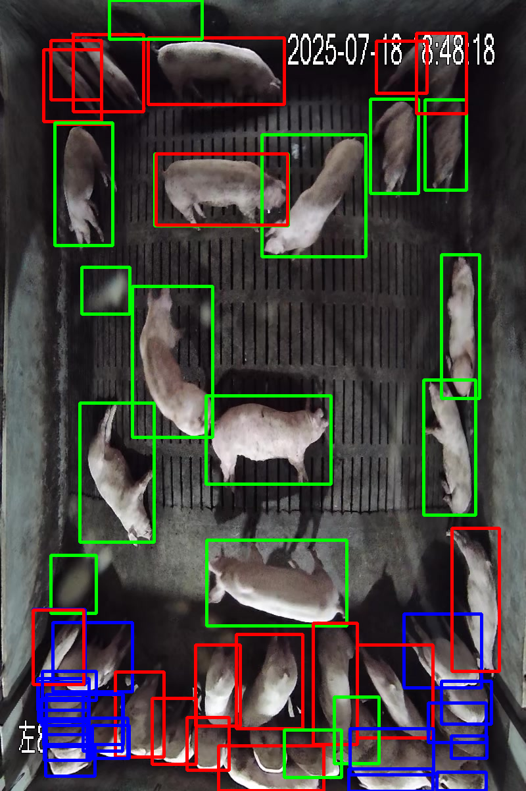
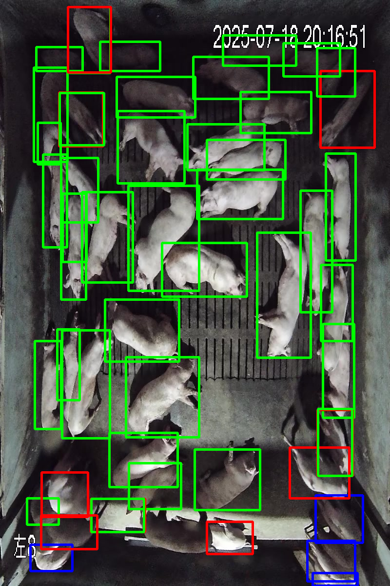

# BCCL

**Official implementation for the paper "Edge-Cloud Collaborative Continual Learning in Smart Livestock Monitoring".**

**Authors:** Zusheng Zhang, Zhenhua Ye, Ling Yin, Yinjie Kuang, SuMin Zhang, Rongjin Jiang

## Overview

Long-term smart livestock monitoring faces challenges arising from data distribution shifts caused by livestock growth, illumination variations, and changing monitoring conditions, leading to performance degradation of edge detection models.

To address these challenges, we propose a **Behavior-aware Cloud-edge Continual Learning (BCCL)** framework for long-term smart livestock monitoring.

BCCL consists of three main components:

- **Behavior-aware sample selection:** Selects informative samples based on prediction confidence and livestock behavioral activity to reduce data transmission.
- **Cloud-side continual learning:** Combines teacher-guided pseudo-supervision and source-domain replay to support model adaptation while retaining previously learned detection capabilities.
- **History-aware deployment:** Utilizes historical models and shadow validation to support model deployment decisions.

## Framework

The overall architecture of BCCL is illustrated below.

## Qualitative Results

Representative pig detection results are presented under four monitoring conditions: Day, Night, Feeding, and Light.

The detected behaviors include standing (red), lying (green), and eating (blue).

### Day and Night

| Day | Night |
|:---:|:---:|
|  |  |

### Feeding and Light

| Feeding | Light |
|:---:|:---:|
|  |  |

## Dataset

The experimental data were collected from an operational commercial pig farm in Guangdong, China.

The experiments use 36 selected video sequences covering three pig growth stages (T1, T2, and T3). Each growth stage includes four representative monitoring conditions: Day, Night, Feeding, and Light.

Model performance is assessed using a separate offline evaluation dataset.

### Data Availability

Due to the large volume of the original video dataset, only a representative subset is provided in this repository.

Additional data may be available from the corresponding author upon reasonable request, subject to applicable data-sharing permissions and restrictions.

**Contact:** Ling Yin (yin_ling@scau.edu.cn)

## Experimental Results

Across 12 monitoring scenarios, BCCL achieves the following average performance:

| Metric | Result |
|---|---:|
| mAP50 | 74.26% |
| BehAcc@50 | 91.79% |
| mAP50 improvement over Source-only | +5.81 percentage points |

Compared with the Full-upload strategy, the proposed behavior-aware sample selection achieves:

- **85.67% reduction** in data transmission.
- **3.99 percentage points improvement** in average mAP50.

## Code

The repository is intended to provide the core implementation of BCCL, including behavior-aware sample selection, cloud-side continual learning, and history-aware deployment.

Detailed installation and execution instructions will be provided with the code release.

## Citation

If you find this work useful, please consider citing our paper:

**Edge-Cloud Collaborative Continual Learning in Smart Livestock Monitoring**

The complete citation information will be added after publication.

## Contact

For questions regarding the code, dataset, or paper, please contact:

**Ling Yin**  
South China Agricultural University  
Email: yin_ling@scau.edu.cn

